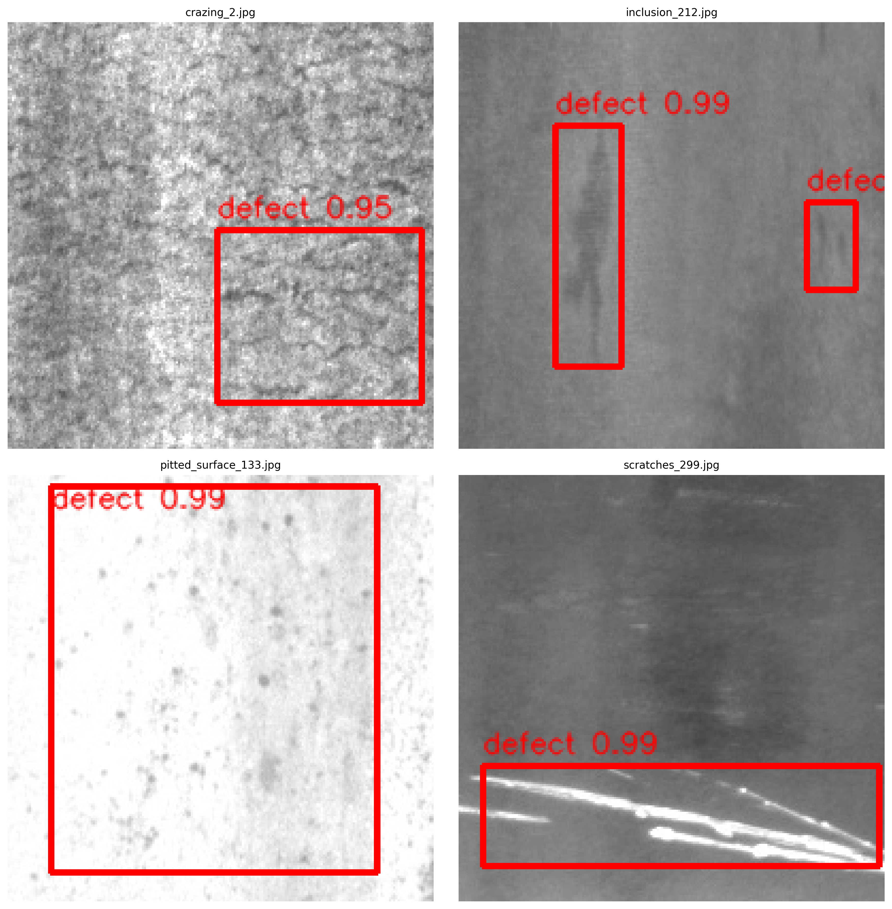
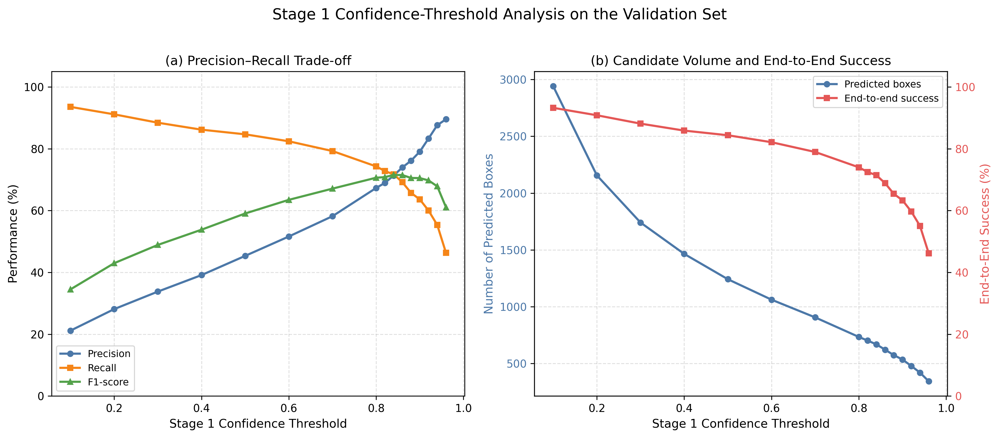
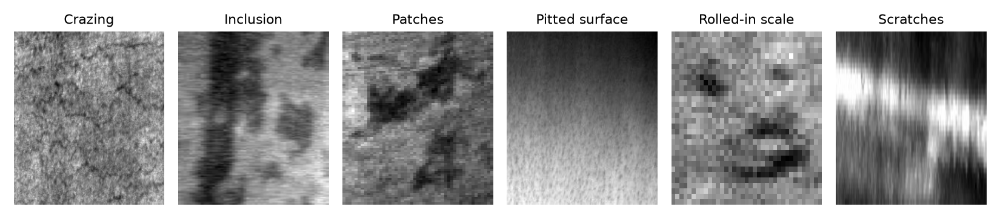
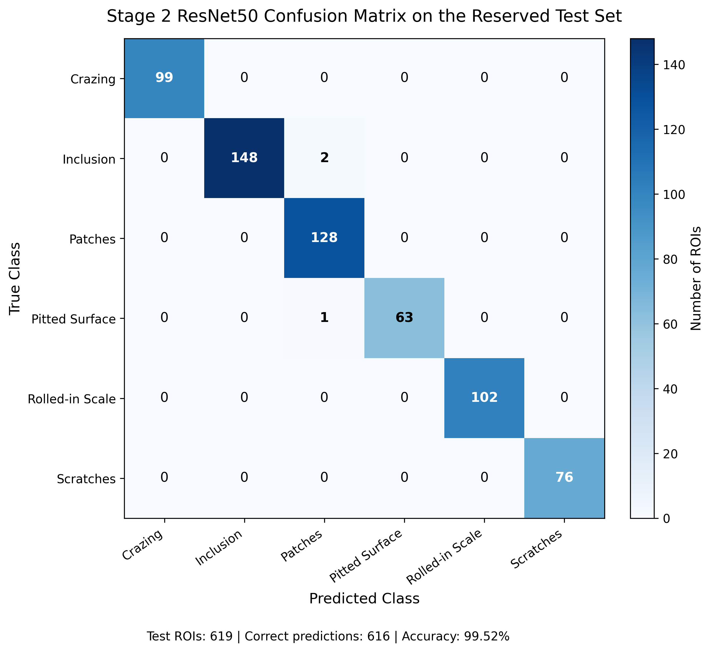
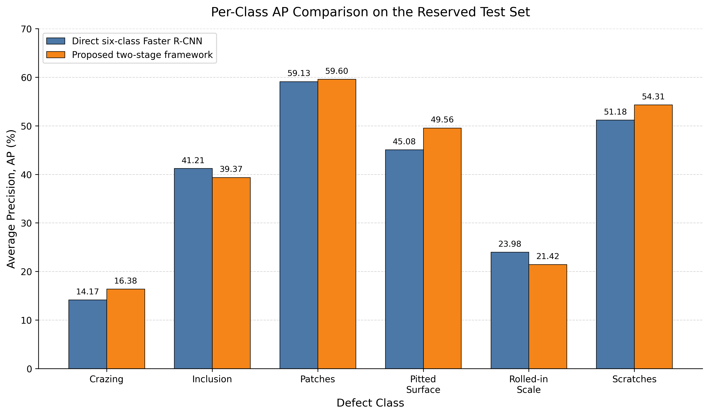
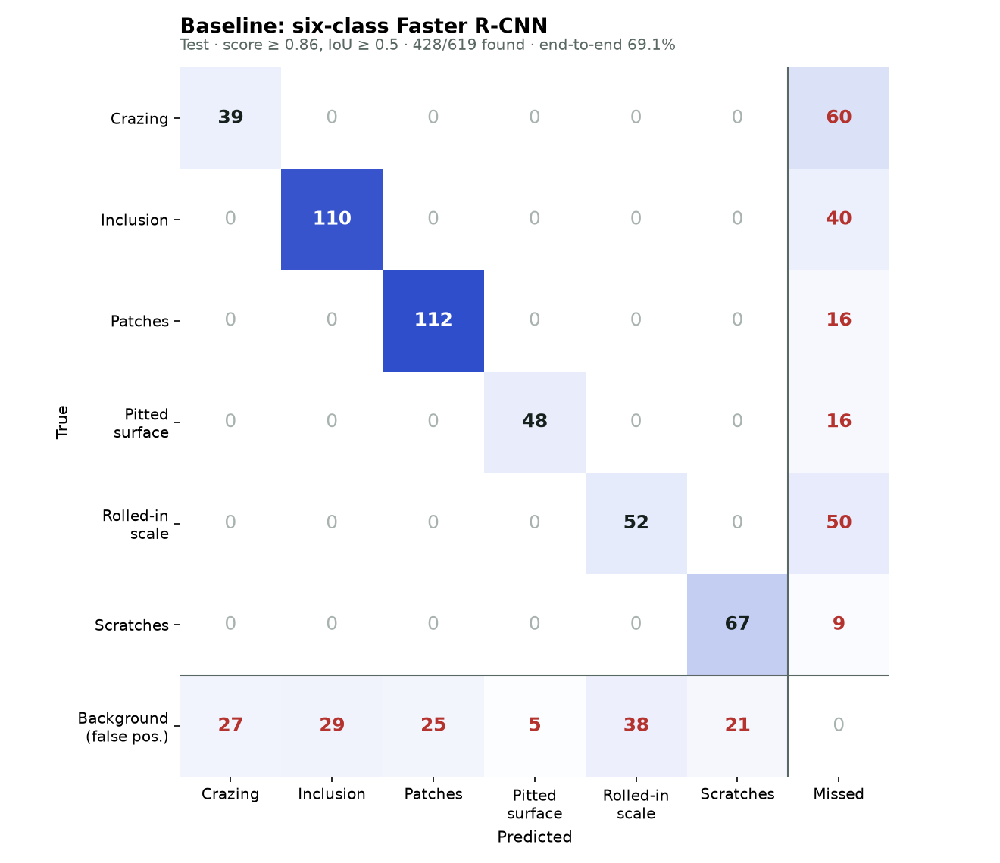
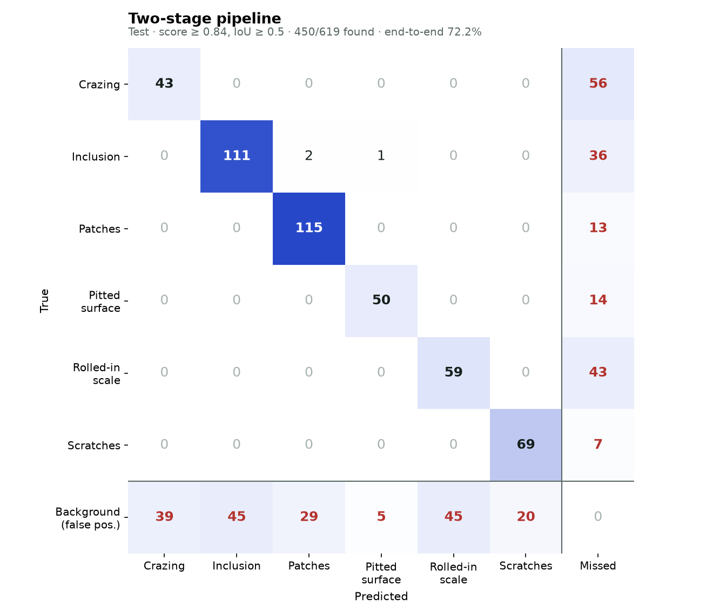

# Two-Stage Surface Defect Detection on NEU-DET

Find and name defects on hot-rolled steel images by splitting the job in two: one model finds defects, a second one decides what kind they are. The pipeline is compared against a single six-class detector trained on the same data.

1. **Stage 1 — localization.** A Faster R-CNN (ResNet-50 FPN, Detectron2) detects class-agnostic "defect" regions.
2. **Stage 2 — classification.** Each detected region is cropped with 10% padding and classified into one of six defect types by a ResNet-50.
3. **Baseline.** The same Faster R-CNN trained to detect all six classes directly.

All choices (checkpoints and the confidence threshold) were made on the validation split. The test split was used once, at the end.

| Headline (test split) | Two-stage | Baseline |
|---|---:|---:|
| COCO AP | **0.401** | 0.391 |
| Defects found (IoU ≥ 0.5, of 619) | **450** | 428 |
| Found and correctly named | **447 (72.2%)** | 428 (69.1%) |
| Stage 2 accuracy on true defect boxes | 99.5% | – |

## Contents

- [Summary](#summary)
- [Steps](#steps)
- [Stage 1: finding defects](#stage-1-finding-defects)
- [Stage 2: naming the defect](#stage-2-naming-the-defect)
- [Baseline: one six-class detector](#baseline-one-six-class-detector)
- [Two-stage vs baseline](#two-stage-vs-baseline)
- [What I learned](#what-i-learned)
- [Setup](#setup), [Dataset](#dataset), [Reproducing the results](#reproducing-the-results), [Repository layout](#repository-layout)

## Summary

Each NEU-DET image shows a 200×200 grayscale patch of steel with one or more defects of six types: crazing, inclusion, patches, pitted surface, rolled-in scale and scratches. Some types, like crazing and rolled-in scale, look a lot like normal surface texture, which makes them hard to box.

The two-stage pipeline first runs a Faster R-CNN that only answers "is there a defect here?" (one class). Every box it finds is cropped with 10% padding and passed to a ResNet-50 that picks one of the six types. The baseline is the same Faster R-CNN trained to detect all six classes directly.

| | |
|---|---|
| Type | Object detection research |
| Language | Python |
| Libraries | PyTorch, torchvision, Detectron2, pycocotools |
| Models | Faster R-CNN (ResNet-50 FPN), ResNet-50 classifier |
| Data | NEU-DET: 200×200 grayscale, 6 defect classes |
| Split | 1,259 / 269 / 271 images (train / val / test) |

## Steps

1. **Clean and split the data.** Hashed all 1,800 images with SHA-256 and found one exact duplicate (`patches_105.jpg` = `patches_101.jpg`, with different labels), leaving 1,799. Made a stratified 70/15/15 split with seed 42: 1,259 / 269 / 271 images and 2,902 / 665 / 619 boxes.
2. **Build three datasets from the split.** Stage 1: COCO boxes with a single "defect" class. Stage 2: every ground-truth box cropped with 10% padding into a folder per class. Baseline: COCO boxes with all six classes.
3. **Train Stage 1.** Detectron2 Faster R-CNN R50-FPN from COCO weights, 1 class, 3,000 iterations, batch 8, learning rate 0.00025 dropped ×0.1 at 2,000 and 2,600. Saved a checkpoint every 250 iterations and kept iteration 2,749, the best on validation (AP 0.396).
4. **Train Stage 2.** ResNet-50 from ImageNet weights on 224×224 crops, AdamW (lr 1e-4, weight decay 1e-4), batch 64, a class-balanced sampler, and flip, ±8° rotation and brightness/contrast jitter. Kept epoch 8, the best on validation (99.4%).
5. **Train the baseline.** The same Faster R-CNN and schedule with 6 classes. Kept iteration 2,499, the best on validation (AP 0.379).
6. **Choose an operating threshold on validation.** Swept the Stage 1 confidence from 0.1 to 0.96 and took the highest F1: **0.84** (F1 0.715).
7. **Evaluate once on test.** COCO AP for all three detectors at score ≥ 0.05, then a box-by-box check at the chosen threshold with greedy one-to-one matching at IoU ≥ 0.5.

## Stage 1: finding defects

On the test split, Stage 1 reaches **AP 0.414**, AP50 0.789 and AP75 0.381 for the single "defect" class, with recall 0.567 over 100 detections. At the chosen threshold of 0.84 it proposes 633 boxes and finds 450 of the 619 defects (recall 72.7%).



*Stage 1 boxes on test images, with confidence scores.*



*Validation sweep used to pick 0.84: precision, recall and F1 (left), and how many boxes pass and how many defects end up correctly classified (right). Data: [`threshold_sweep.csv`](results/dedup_run1/validation/threshold_sweep/threshold_sweep.csv).*

## Stage 2: naming the defect

Given the true boxes from the test split, the classifier labels **616 of 619 crops correctly (99.5%)**. The only errors are two inclusions and one pitted surface called patches. On the 450 boxes Stage 1 actually found, accuracy is 99.3%.



*What Stage 2 sees: one padded test crop per class.*



*Stage 2 confusion matrix on ground-truth test crops.*

## Baseline: one six-class detector

The baseline reaches **AP 0.391**, AP50 0.754 and AP75 0.353 on the test split. To compare it box by box, its threshold was picked the same way, by the best F1 on validation (**0.86**, F1 0.713; see [`baseline_threshold_sweep`](results/dedup_run1/validation/baseline_threshold_sweep/threshold_sweep.csv)), and the same IoU ≥ 0.5 matching was used. It proposes 573 boxes and finds 428 defects.

## Two-stage vs baseline

| Test split, 271 images, 619 defects | Baseline | Two-stage |
|---|---:|---:|
| COCO AP | 0.391 | **0.401** |
| AP50 | 0.754 | **0.762** |
| AP75 | 0.353 | **0.368** |
| Threshold (chosen on validation) | 0.86 | 0.84 |
| Boxes proposed | 573 | 633 |
| Defects found (IoU ≥ 0.5) | 428 | **450** |
| Found and correctly named | 428 (69.1%) | **447 (72.2%)** |
| False positives | **145** | 183 |
| Precision / recall | **74.7%** / 69.1% | 71.1% / **72.7%** |
| F1 | 0.718 | 0.719 |

COCO AP uses a score threshold of 0.05 for both models. The operating-point rows come from [`detection_confusion/summary.json`](results/dedup_run1/test/detection_confusion/summary.json).

Per-class AP on the test split:

| Class | Baseline | Two-stage |
|---|---:|---:|
| crazing | 0.142 | **0.164** |
| inclusion | **0.412** | 0.394 |
| patches | 0.591 | **0.596** |
| pitted_surface | 0.451 | **0.496** |
| rolled-in_scale | **0.240** | 0.214 |
| scratches | 0.512 | **0.543** |



| Baseline | Two-stage |
|---|---|
|  |  |

*Detection confusion matrices on the test split. The last column counts defects that no box matched; the last row counts boxes that matched no defect. CSVs: [`detection_confusion/`](results/dedup_run1/test/detection_confusion/).*

## What I learned

- The two-stage pipeline finds 22 more defects and names 19 more correctly, at the cost of 38 more false positives. F1 is the same, so the gain is in recall, which matters most when a missed defect is expensive.
- Classification is close to solved: both pipelines almost never confuse two defect types once a box is found. Nearly all remaining error is localization.
- Crazing and rolled-in scale are the hardest: even the two-stage pipeline misses 56 of 99 crazing and 43 of 102 rolled-in scale defects. A better Stage 1 is the next thing to improve.
- Removing the duplicate before splitting and choosing every threshold on validation keeps the test numbers honest.

## Setup

Python 3.10+ with a CUDA GPU is recommended for training. Evaluation also runs on CPU with `--device cpu`.

1. Install PyTorch and torchvision for your platform from [pytorch.org](https://pytorch.org/get-started/locally/).
2. Install Detectron2 by following its [installation guide](https://detectron2.readthedocs.io/en/latest/tutorials/install.html). On Windows it has to be built from source with the Visual C++ build tools.
3. Install the remaining packages:

```bash
pip install -r requirements.txt
```

## Dataset

This repository does not include the NEU-DET images or annotations. Download the NEU surface defect database (NEU-DET, 1,800 grayscale 200×200 images, 6 classes, Pascal VOC XML boxes) from its original source and follow its terms of use. Place it as:

```
data/raw/neu_det/
├── images/        # or IMAGES/
└── annotations/   # or ANNOTATIONS/, one .xml per image
```

Cite the dataset if you use it:

- K. Song and Y. Yan, "A noise robust method based on completed local binary patterns for hot-rolled steel strip surface defects," *Applied Surface Science*, 2013.
- Y. He, K. Song, Q. Meng, and Y. Yan, "An end-to-end steel surface defect detection approach via fusing multiple hierarchical features," *IEEE Transactions on Instrumentation and Measurement*, 2020.

## Reproducing the results

Run every command from the repository root.

**1. Prepare the data.** This removes byte-identical duplicates (SHA-256), makes a stratified 70/15/15 train/val/test split with seed 42, and writes the Stage 1 COCO data, the Stage 2 ROI crops and the six-class baseline data to `data/processed/`. The split is deterministic, so no split files are needed.

```bash
python scripts/data/prepare_neu_det.py
python scripts/data/prepare_baseline_6class.py
python scripts/data/check_coco.py   # optional: writes preview images with boxes
```

**2. Train.** Checkpoints and logs go to `runs/training/` (ignored by Git).

```bash
python scripts/train/train_stage1.py
python scripts/train/train_stage2.py
python scripts/train/train_baseline_6class.py
```

**3. Select the operating threshold on validation data only.** This gives 0.84.

```bash
python scripts/evaluate/validate_threshold_sweep.py
```

**4. Evaluate on the test split.** See [`scripts/evaluate/README.md`](scripts/evaluate/README.md) for details.

```bash
python scripts/evaluate/evaluate_detector_coco.py --experiment baseline --split test --score-threshold 0.05
python scripts/evaluate/evaluate_detector_coco.py --experiment stage1 --split test --score-threshold 0.05
python scripts/evaluate/evaluate_stage2_classifier.py --split test
python scripts/evaluate/evaluate_two_stage_coco.py --split test --stage1-score-threshold 0.05 --roi-padding-ratio 0.10
python scripts/evaluate/validate_end_to_end.py --split test --stage1-score-threshold 0.84 --match-iou-threshold 0.50 --roi-padding-ratio 0.10
```

**5. Compare the two pipelines box by box.** Uses the saved predictions only (no GPU): picks the baseline threshold on validation, then writes both detection confusion matrices.

```bash
python scripts/evaluate/detection_confusion_from_predictions.py
```

**6. Make the figures.**

```bash
python scripts/figures/make_fig_6_1_stage1_examples.py
python scripts/figures/make_fig_6_2_confusion_matrix.py
python scripts/figures/make_fig_6_3_threshold_analysis.py
python scripts/figures/make_fig_6_4_per_class_ap.py
# figures 6.5-6.7 are written by step 5
```

Trained weights are not included. Training with the fixed seeds should give results close to the ones above, but GPU nondeterminism can cause small differences.

## Repository layout

```
src/neu_det_two_stage/   # shared project paths and helpers
scripts/
├── data/                # dataset preparation and checks
├── train/               # Stage 1, Stage 2, and baseline training
├── evaluate/            # COCO evaluation, end-to-end validation, threshold sweep, detection confusion
└── figures/             # result figures
results/
├── dedup_run1/          # final results on the deduplicated split (reported above)
│   ├── validation/      # checkpoint selection, threshold sweeps, validation metrics
│   ├── test/            # test metrics, detection confusion matrices and figures
│   └── predictions/     # saved test/validation predictions used for the box-by-box comparison
├── validation/, test/   # earlier run, before duplicate images were removed
docs/figure_specs/       # text diagrams of the method
```

Metrics are stored as `summary.json` plus CSV files (per-class AP, confusion matrices). Paths inside them are relative to the repository root.

## License

The code is released under the [MIT License](LICENSE). The NEU-DET dataset is not covered by this license; the example images in `results/*/figures/` are derived from NEU-DET and remain subject to the dataset's terms.
